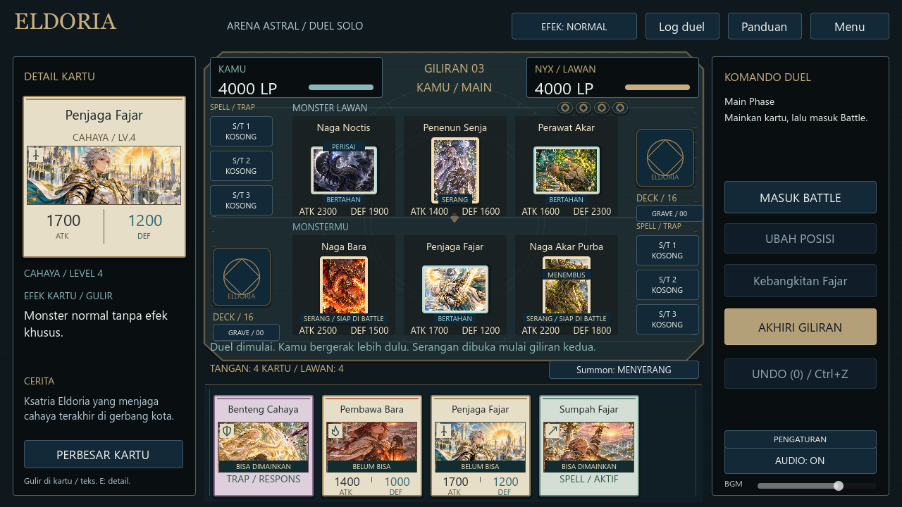

# Tahap 1 — Arena dan posisi kartu

Implementasi 18 November 2026, Godot 4.7, resolusi desain 1280×720. Tahap berikutnya belum dikerjakan.

## Keputusan dan perubahan

Audit menemukan kartu zona 146×142 hampir persegi, seluruh teks ikut berputar saat bertahan, serta ukuran dan offset snapshot berulang di beberapa fungsi. Dua dokumen lokal yang belum terlacak Git, `CODEX_HANDOFF.md` dan `development-roadmap.md`, dipertahankan.

Memperkecil dan memutar seluruh Button akan tetap memutar teks serta mengubah bidang klik. Memperbesar zona memerlukan perubahan layout arena yang lebih luas. Pilihan implementasi adalah memisahkan badan kartu yang digambar dari informasi dan bidang kliknya, di dalam CardView yang sudah ada.

- Badan kartu 68×94, rasio sekitar 0,72. Posisi bertahan memutar badan −90° sehingga menjadi 94×68. Nama, ATK/DEF, status posisi, perisai, dan menembus tetap horizontal. Petunjuk kesiapan serta warna statistik naik/turun dipertahankan.
- Zona tetap 146×142 sebagai area klik penuh, termasuk nama, statistik, dan ruang di sekitar badan kartu. Fokus keyboard dan pilihan memakai garis zona. Klik kanan, hover, dan gulir tetap memakai jalur input lama.
- `CardView.FIELD_SIZE`, `FIELD_CENTER`, dan `FIELD_BODY` menjadi acuan layout, pusat efek, pivot, summon, serangan, dan snapshot target. Pusat badan berada pada offset (73,77).
- Pergantian posisi kartu dengan UID yang sama memakai tween 0,24 detik pada 1x, 0,16 pada 1,5x, dan 0,12 pada 2x. Kartu baru langsung memakai orientasi model. Ringkas menyelesaikan rotasi aktif langsung; Undo/restart membatalkan tween lama.
- Snapshot mempertahankan data sebelum impact, termasuk posisi bertahan, setelah model menghapus target.
- Tombol Grave disetel kembali ke 95×24 setelah ukuran font diterapkan. Ukuran minimum dari teks awal sebelumnya membuat tombol melebar hingga menutupi statistik zona pertama.
- Tidak ada perubahan aturan duel, katalog, save, balance, atau aset baru.

## Bukti otomatis

13 script relevan dijalankan dan lolos: `test_field_layout`, `test_cinematic_duel`, `test_presentation`, `test_vfx`, `test_ui`, `test_undo_ui`, `test_comfort_ui`, `test_hand_selection`, `test_card_description_scroll`, `test_expansion`, `test_expansion_ui`, `test_strategy_ui`, dan `test_undo`.

Tes baru `test_field_layout.gd` mencakup 142 pemeriksaan headless, atau 147 saat renderer grafis menyimpan lima PNG. Cakupannya:

- Orientasi enam zona, pusat efek, dan klik melalui input viewport di pusat serta dua sudut setiap zona.
- Seluruh sudut badan kartu tetap dalam zona pada 19 sampel sudut rotasi.
- Tombol pergantian posisi, 1x/1,5x/2x, dan Undo.
- Summon bertahan, pemilihan target Penenun Senja, dan pergantian posisi lawan.
- Snapshot target yang modelnya sudah dihapus, termasuk serangan nyata dan Undo sebelum impact selesai.
- Ringkas saat rotasi berlangsung, restart, serta visibilitas setelah callback lama dibatalkan.

Tes regresi turut mencakup 378 pemeriksaan VFX, 20 cinematic, 22 presentation, 15 Undo UI, 25 comfort UI, 16 gulir deskripsi, 37 strategy UI, dan 70 Undo model. Log akhir script tes tidak memuat error atau warning. `git diff --check` bersih.

Setiap script memakai APPDATA sementara yang terpisah dari profil permainan pribadi. Tes baru menghentikan dan melepaskan stream musik sebelum keluar agar shutdown headless tidak meninggalkan resource audio.

## Render dan interaksi jendela

Render aktual memakai OpenGL Compatibility pada AMD Radeon, 1280×720. Lima PNG diperiksa: posisi kedua sisi, summon bertahan, snapshot target, snapshot pertarungan, dan Ringkas. Perbaikan ukuran tombol Grave diperiksa pada render akhir.



Interaksi melalui jendela Windows dilakukan oleh agen memakai mouse/keyboard: Mulai Duel, hasil koin, masuk arena, memilih mode bertahan, memilih kartu tangan yang terangkat, summon ke zona tengah, Ctrl+Z, serta menggulir efek Sumpah Fajar. Hasil diamati melalui tangkapan jendela. Ini terpisah dari tes script dan bukan playtest oleh pemain manusia.

## Mencoba dan reproduksi

Import `project.godot` lalu F5. Pilih mode summon BERTAHAN sebelum memainkan monster. Pada giliran berikutnya pilih monster dan UBAH POSISI. Bandingkan Normal/Ringkas serta 1x/1,5x/2x di Pengaturan; coba Ctrl+Z saat animasi berlangsung. Klik kanan membuka kartu besar, roda mouse menggulir deskripsi.

Contoh PowerShell dari folder proyek, memakai executable lokal yang tersedia saat pemeriksaan:

```powershell
$godot = 'C:\Users\Kafka\Documents\Codex\2026-10-30\google-drive-plugin-google-drive-openai-6\work\godot47\Godot_v4.7-stable_win64_console.exe'
$previousAppData = $env:APPDATA
try {
    $env:APPDATA = Join-Path $env:LOCALAPPDATA "Temp\eldoria-arena-$([guid]::NewGuid())"
    New-Item -ItemType Directory -Force $env:APPDATA, build/arena-review | Out-Null
    & $godot --path . --audio-driver Dummy --log-file build/arena-review/field-render.log --script res://tests/test_field_layout.gd -- --capture-dir=build/arena-review
} finally {
    $env:APPDATA = $previousAppData
}
```

Tambahkan `--headless` untuk tes tanpa gambar. Folder `build/` diabaikan Git. Satu render final disalin ke dokumentasi; log dan render tambahan tetap lokal.

## Batas pemeriksaan

Belum ada playtest manusia, pengukuran FPS, atau uji lintas GPU/DPI. Nama yang terlalu panjang dapat dipotong setelah dua baris; kartu besar dan panel detail tetap tersedia. Animasi summon/serangan masih menggerakkan ghost beserta label, sedangkan rotasi pergantian posisi hanya memutar badan kartu.

Menutup sesi desktop dengan audio driver Dummy memunculkan warning delapan instance audio Ogg dan empat resource masih digunakan saat shutdown. Tes memiliki cleanup eksplisit dan bersih; lifecycle audio aplikasi belum diperbaiki pada tahap arena ini. Audio tidak dinilai melalui pendengaran.
