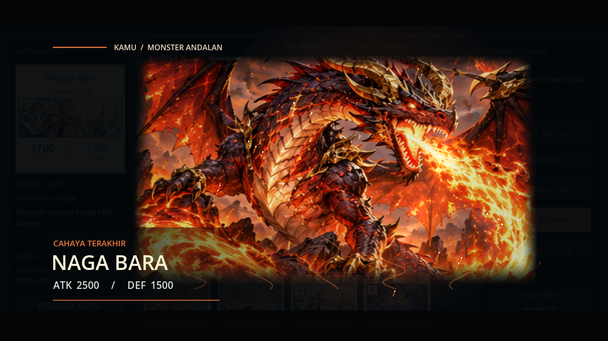

# Animasi duel 2.5D

Implementasi 10 November 2026 untuk Godot 4.7 Compatibility. Menggunakan ilustrasi dan audio Eldoria yang sudah ada, tanpa dependensi tambahan.

## Yang berubah

- Summon pertama tiap monster andalan, per sisi dan per duel: panggung 1280×720 dengan proyeksi perspektif ilustrasi, gerak mendekat, sorotan cahaya, latar atmosfer, dan partikel depan. Naga Bara memakai bara; Noctis bulan sabit dan pecahan orbit; Akar Purba akar dan daun.
- Nama dan statistik tetap diam agar mudah dibaca. Cut-in 1,90 detik pada 1x atau 0,95 detik pada 2x; summon berulang tidak mengulang cut-in. Undo mengembalikan status pemunculannya.
- Summon biasa naik dari tangan dengan rotasi kecil dan perubahan skala. Serangan memiliki antisipasi, luncuran menuju target, lalu kembali. Target bereaksi saat benturan.
- Suara serangan kecil/besar dijadwalkan bersamaan dengan impact profil kartu. Bunyi puncak cut-in dimiliki node animasinya sehingga ikut dibatalkan saat node dihapus.
- Benturan mendapat cahaya lokal, garis arah, dan cincin berdasarkan kekuatan. Serangan yang akan menghabiskan LP lawan mendapat gelombang elips di arena. Penentuan lethal disimpan sebelum model mengurangi LP, termasuk saat presentasi ditunda oleh trap.
- Trap bergerak dari slot asal, berputar membuka, lalu menampilkan informasi efek. Durasi presentasi normal menjadi 0,85 detik per trap; Ringkas tetap 0,38 detik, sebelum penyesuaian kecepatan.
- Pantulan foil pada hover terbatas pada ilustrasi; teks kartu tetap diam.

## Mencoba

Import `project.godot` dan tekan F5. Gunakan efek NORMAL dan kecepatan 1x di Pengaturan. Summon monster level rendah terlebih dahulu, lalu tribute untuk monster andalan. Coba ketiga preset deck untuk melihat ketiga tema. Bandingkan mode Ringkas dan kecepatan 2x, lalu Undo ketika summon atau serangan berlangsung.

## Pemeriksaan

Hasil akhir: **29 script pengujian lolos**, tanpa error atau warning. Termasuk 378 pemeriksaan VFX untuk 34 profil kartu, 22 pemeriksaan presentasi, 15 pemeriksaan Undo UI, dan 25 pemeriksaan kenyamanan bermain. `git diff --check` juga bersih.

`tests/test_cinematic_duel.gd` mencakup 20 pemeriksaan: ketiga cut-in, pelepasan input, pemunculan sekali, 2x, pergantian Ringkas, lethal, Undo, shield/DEF, serta replay serangan nonlethal setelah antrean trap.

`tests/preview_cinematic.gd` merender ketiga monster dan impact langsung di Godot. Jalankan tanpa `--headless` dengan `--script res://tests/preview_cinematic.gd -- --capture-dir=<folder-yang-sudah-ada>` untuk tangkapan PNG. Hasil telah diperiksa pada renderer OpenGL Compatibility AMD Radeon, 1280×720.

Untuk seluruh `tests/test_*.gd`, gunakan direktori APPDATA sementara yang **berbeda untuk setiap script** dan `--log-file` pada folder sementara yang dapat ditulis. Beberapa tes mengubah preferensi; memakai satu profil bersama membuat tes berikutnya mewarisi mode Ringkas atau kecepatan sebelumnya. Jangan menjalankannya memakai profil permainan pribadi.

## Batasan

Efek 2.5D ini memakai proyeksi dan lapisan gambar; karakter belum memiliki rig tulang atau bagian tubuh terpisah. Detail ilustrasi atlas lama membatasi ketajaman ketika diperbesar. Belum ada pengukuran FPS lintas perangkat. Shader menghormati modulasi alpha agar ilustrasi dan panggung memudar bersama. Aturan duel, katalog, deck, dan naskah cerita tidak diubah oleh implementasi animasi ini.
